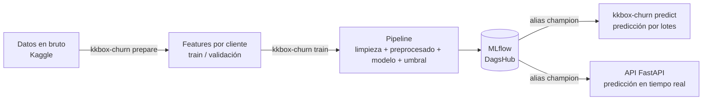

# KKBox Churn Prediction

Predicción de abandono de clientes para un servicio de streaming musical por suscripción, desde los datos en bruto hasta un modelo versionado en MLflow y listo para servirse.

**Experimentos y modelos:** [MLflow en DagsHub](https://dagshub.com/gloriadrm/kkbox-churn-prediction.mlflow)

## El problema

KKBox, un servicio de streaming musical asiático, quiere anticipar qué suscriptores no renovarán su suscripción tras su vencimiento. Detectarlos a tiempo permite lanzar acciones de retención (descuentos, recordatorios, ofertas) antes de perderlos.

El reto principal es el **desbalanceo**: solo el **9 %** de los clientes hace churn, así que un modelo que dijera "nadie se va" acertaría el 91 % de las veces sin ser útil.

## Resultados

Evaluados sobre un conjunto de validación que el modelo no ve ni para entrenar ni para elegir el umbral (291.288 clientes):

| Métrica | Valor | Lectura |
|---|---|---|
| **Average precision (PR-AUC)** | **0,73** | 8 veces mejor que el azar (0,09) |
| ROC-AUC | 0,92 | Muy buena capacidad de ordenar clientes por riesgo |
| Recall de churn | 81 % | Detecta 8 de cada 10 clientes que se van |
| Precisión de churn | 43 % | De cada 10 clientes marcados, 4 se van de verdad |
| Clientes marcados | 17 % | Volumen que tendría que gestionar el equipo de retención |

**En términos de negocio:** contactando al 17 % de los clientes se captura el 81 % del churn.

## Enfoque

**Datos.** Tres tablas de Kaggle: etiquetas de churn, perfil de los miembros y un histórico de transacciones de casi 1 GB, agregado a una fila por cliente (970.960 clientes).

**Prevención de *data leakage*.** Todas las variables se calculan solo con información anterior a una **fecha de corte** (1 de marzo de 2017), para que el modelo no use datos del futuro que no tendría en producción.

**Feature engineering.** Unas 40 variables por cliente: recencia, antigüedad, días hasta la expiración, frecuencia y regularidad de pagos, tasas de cancelación y renovación automática, comportamiento del último día de transacciones, etc.

**Calidad de datos.** Edades fuera de rango convertidas en nulos con un indicador `age_unknown`, imputación con medianas aprendidas solo en train y validación automática de tipos y columnas.

**Selección de modelo.** Comparación de regresión logística (L1, L2, Elastic Net), Random Forest, XGBoost y HistGradientBoosting con búsqueda de hiperparámetros y validación cruzada. Ganó **HistGradientBoosting**, sin overfitting (AUC de train y validación prácticamente iguales).

**Umbral de decisión.** En lugar del 0,5 por defecto (inadecuado con un 9 % de churn), el umbral se ajusta en cada entrenamiento con validación cruzada siguiendo el **criterio de Youden** y se guarda junto al modelo. Prioriza no dejar escapar clientes, asumiendo que una acción de retención es barata frente al coste de perder un suscriptor.

**Champion / challenger.** Cada reentrenamiento registra una nueva versión del modelo en MLflow, pero solo sustituye al modelo en producción (`champion`) si mejora su **average precision** en validación. Se elige esta métrica porque, con clases desbalanceadas, se centra en la clase que importa y no depende del umbral.

## Arquitectura



## Estructura del proyecto

```
├── src/kkbox_churn/
│   ├── config.py            # rutas, columnas, hiperparámetros y MLflow
│   ├── cli.py               # comandos prepare / train / predict
│   ├── data/                # carga de datos y construcción del dataset
│   ├── features/            # feature engineering desde las tablas en bruto
│   ├── preprocessing/       # calidad de datos y transformaciones (sklearn)
│   └── models/              # entrenamiento, predicción, evaluación y tracking
├── notebooks/
│   ├── dev/                 # exploración, EDA y experimentación
│   └── pro/                 # flujo de producción paso a paso
└── pyproject.toml
```

## Cómo ejecutarlo

**1. Instalar** (requiere [uv](https://docs.astral.sh/uv/))

```bash
uv sync --extra dev
```

**2. Datos.** Descarga `train_v2.csv`, `members_v3.csv`, `transactions.csv` y `transactions_v2.csv` del [reto de Kaggle](https://www.kaggle.com/c/kkbox-churn-prediction-challenge/data) en `data/raw/`.

**3. MLflow (opcional).** Sin configuración, los experimentos se guardan en local (`mlflow.db`). Para usar un servidor remoto, crea un archivo `.env`:

```bash
MLFLOW_TRACKING_URI=https://dagshub.com/<usuario>/<repo>.mlflow
MLFLOW_TRACKING_USERNAME=<usuario>
MLFLOW_TRACKING_PASSWORD=<token>
```

**4. Pipeline**

```bash
uv run kkbox-churn prepare    # construye las features y separa train / validación
uv run kkbox-churn train      # entrena, evalúa y registra el modelo en MLflow
uv run kkbox-churn predict    # predicción por lotes con el modelo champion
```

`train --force-promote` promueve el nuevo modelo aunque no mejore al actual (por ejemplo, si cambian las features).

## API

```bash
uv run uvicorn kkbox_churn.api.main:app
```

Documentación interactiva en `http://127.0.0.1:8000/docs`.

| Endpoint | Descripción |
|---|---|
| `GET /health` | Estado de la API, versión y umbral del modelo cargado |
| `POST /predict` | Probabilidad y clase de churn de un cliente |
| `POST /predict/batch` | Lo mismo para hasta 1.000 clientes |

Las entradas se validan con Pydantic (tipos, rangos y campos desconocidos). Los valores ausentes se imputan igual que en el entrenamiento, y se registra un aviso si a un cliente le falta más de la mitad de las features.

## Stack

Python · pandas · scikit-learn · MLflow · DagsHub · FastAPI · Pydantic · uv

## Roadmap

- [x] Feature engineering con prevención de *data leakage*
- [x] Comparación de modelos y ajuste de hiperparámetros
- [x] Ajuste del umbral de decisión
- [x] Paquete Python reproducible con CLI, logging y control de errores
- [x] Tracking de experimentos y Model Registry con MLflow (champion / challenger)
- [x] API de predicción con FastAPI y Pydantic
- [ ] Docker
- [ ] Tests con pytest e integración continua con GitHub Actions